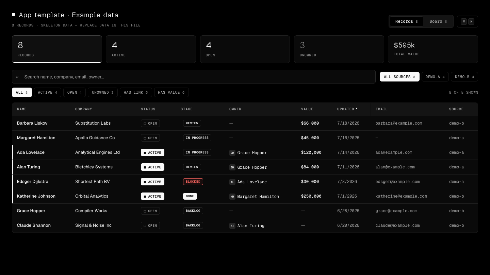
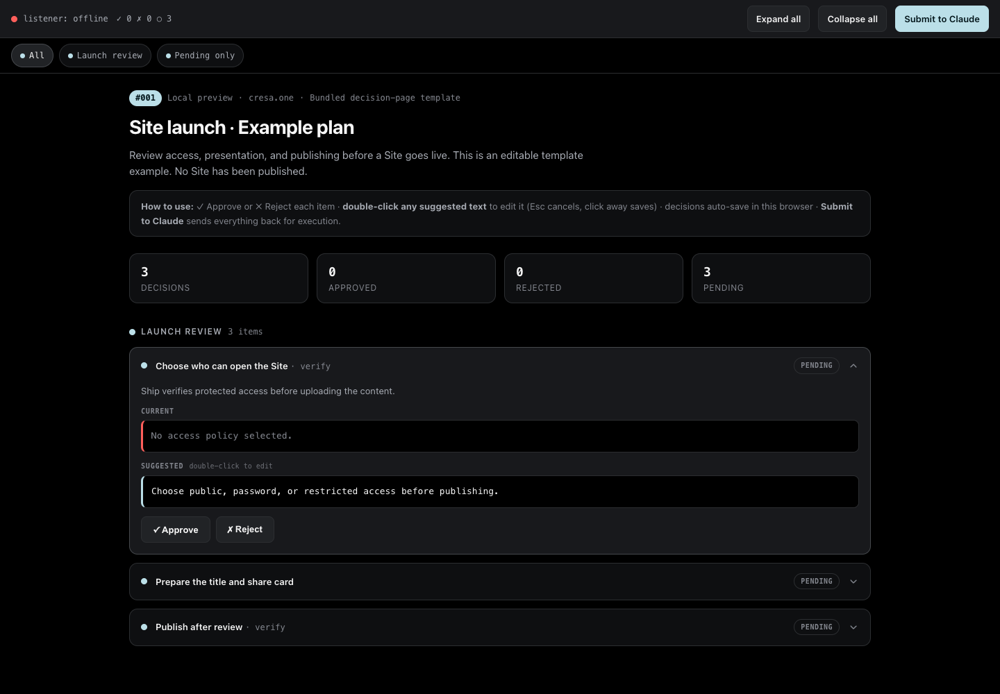
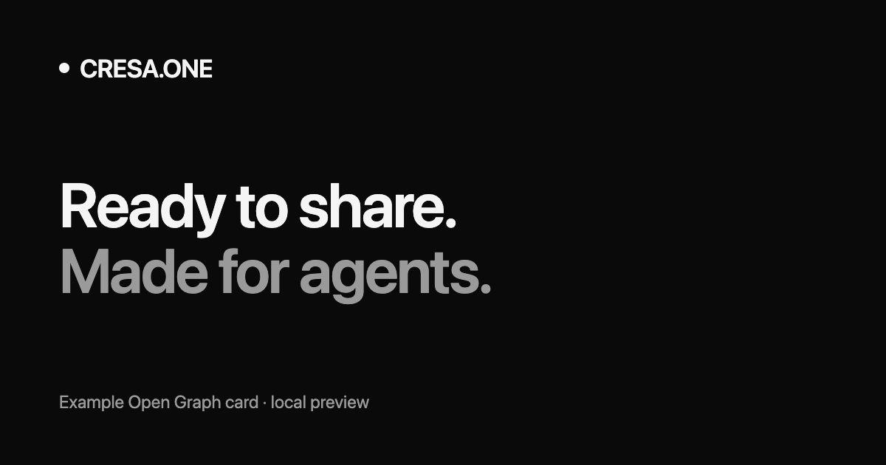

# cresa.one plugin

Publish Sites with verified access, metadata, and share cards; manage, roll back, health-check, and protect them with lead capture, tracked links, and viewer comments. Keep project files in private account-owned Drives.

## Start here

Ask your agent to prepare a local website, publish a report, check a Site, or store files in a Drive. For preparation without publishing, ask for an **offline dry run**.

- “Prepare this site for cresa.one with metadata and a share card. Dry run only.”
- “Restrict this Site, add a lead-capture gate, and verify access.”
- “Check Site health, roll a version back, or store files in a Drive.”

## Skills

Claude Code exposes each skill as `/cresa-one:<name>`; Codex lists the same skills as `cresa-one:<name>`. Agents also pick them automatically from the request.

| Skill | Use it to |
| --- | --- |
| `/cresa-one:publish` | Publish a website, app, report, or files with metadata, a share card, access, and verification |
| `/cresa-one:manage-sites` | Find, update, roll back, retag, rename, archive, claim, recover, or delete existing Sites; act on viewer comments; set up webhooks |
| `/cresa-one:site-health` | Run a read-only check: HTTP, TLS, finalize state, status, expiry, access gate, share image, traffic, 404s; list viewers and engagement |
| `/cresa-one:site-access` | Set a password, restrict to emails or domains, add a lead-capture gate, send invites or tracked recipient links, turn on view alerts, engagement, or comments, brand the gate, or reopen a Site |
| `/cresa-one:drive` | Store, read, import, export, and share private files in Drives with scoped tokens |
| `/cresa-one:domains` | Connect custom domains with self-serve DNS verification and automatic HTTPS, manage the handle and path links |
| `/cresa-one:site-data` | Collect form and poll records with Site Data, and forward protected paths with proxy routes |
| `/cresa-one:cresa-one` | The complete core skill: every workflow, API key sign-in, version checks, and the shared runtime |
| `/cresa-one:setup` | Finish a new install: OAuth sign-in, where credentials live, and the Site card |

`/cresa-one:status` reports bundled versions and helper paths. Claude Code and Cursor also load the `publisher` agent (`cresa-one:publisher`). Cursor loads the publishing rule.

## Included

The focused skills are thin guides. They all run the one runtime inside `skills/cresa-one/`, so helpers are never duplicated:

- `skills/cresa-one/scripts/ship.sh`: prepare HTML, generate share cards, configure and verify access, publish, and check saved settings.
- `publish.sh`: publish files or update a Site's metadata.
- `site-health.sh`: read-only health report for one Site.
- `drive.sh`: manage private Drive files and scoped Drive tokens.
- App and editable decision-page templates, share-card templates, and shipping reference docs.

Paths above are relative to the installed plugin directory. Each focused skill finds the runtime at `../cresa-one/` from its own directory; do not assume the user's working directory is the plugin.

## Requirements and access

Core helpers use Bash, curl, and jq. On Windows they run in Git Bash, which Claude Code on Windows already requires. Complete Site preparation requires Python 3.10+ (`python3`, `python`, or `py -3`). Share-card rendering optionally uses Playwright with Chromium; Pillow is the fallback.

Anonymous Sites are temporary. Owner-managed publishing, metadata, access, and Drive operations require a cresa.one account. Installing this plugin also connects the remote MCP server at `https://mcp.cresa.one/mcp` (Streamable HTTP). The first call opens OAuth: an emailed cresa.one code, then read-only or full access. The plugin files contain no API key, token, or client secret. A Drive owner can share one Drive or folder with another agent through a scoped, revocable Drive token. Keep credentials in the client's sign-in store, never in chat. Deletes, access changes, and other sensitive MCP actions still wait for a person to approve them; the core skill's "Remote MCP server" section lists those actions.

Skills and the MCP server ship together on Claude Code, Codex, and Cursor. Skills prepare files on the machine (metadata, share cards, dry runs, access checks). The MCP server is the live account: Sites, Drives, and approval-gated changes. Neither replaces the other.

## Chat UI

`show_site` returns a Site, or the recent Sites, as structured JSON. Hosts that implement MCP Apps (`ui://` resources, `text/html;profile=mcp-app`) also draw that result as an interactive card with Open, Refresh, and Report. Hosts without MCP Apps still get the JSON. The card is served by `https://mcp.cresa.one/mcp`; the plugin package does not embed a second UI.

`--privacy private` controls search indexing, referrer policy, and profile listing. Select `--access password` or `--access restricted` when content must be gated. Ship checks protected access before upload and reports the actual expiry returned by the service.

## Preview gallery

These are local renders of bundled templates, not live account records or marketplace UI screenshots.







## Install and update

One install per client includes the skills, the `status` command, the `publisher` agent, a session hook that only prints context, and the remote MCP server. Cursor also loads one publishing rule. Sign in when the client asks. Nothing in this package is an API key. The logo and icon are the existing cresa.one artwork.

Marketplace installs below apply after this release reaches the public mirror. Full local-checkout steps: [public README](https://github.com/cresadotone/skill#readme).

### Claude Code

Claude Code reads `.claude-plugin/plugin.json`, `.mcp.json`, `skills/`, `commands/`, `agents/`, and `hooks/hooks.json` inside `plugins/cresa-one`. The session hook does not make network calls. `network.hosts` lists `cresa.one` and `*.cresa.one` for the client's sandbox listing; it does not grant access by itself.

```text
/plugin marketplace add cresadotone/skill
/plugin install cresa-one@cresa-one
```

Then run `/mcp` and sign in. Update with `/plugin marketplace update cresa-one`, `/plugin update cresa-one@cresa-one`, and `/reload-plugins`.

### Codex

Codex reads root `plugin.json` and `mcp.json` in that same folder. The auth block in `mcp.json` is OAuth with dynamic client registration. The manifest does not contain a client id or client secret. Older Codex still reads `.codex-plugin/plugin.json`. That file's `mcpServers` path stays `./.mcp.json`, which is also the Claude HTTP config. Current Codex signs in from `mcp.json`. After install, the `setup` skill is the onboarding skill. `hooks/hooks.json` runs on SessionStart for desktop installs. A package that contains hooks is not eligible for the public OpenAI plugin directory; remove `hooks/` before that submission.

```bash
codex plugin marketplace add cresadotone/skill
codex plugin add cresa-one@cresa-one
```

Start a new task after installing or updating. Update with `codex plugin marketplace upgrade cresa-one`, then `codex plugin add cresa-one@cresa-one`.

### Cursor

Cursor reads root `plugin.json` and `mcp.json` for the Agent Plugins shape, and `.cursor-plugin/plugin.json` for the skills, command, agent, rule, and Cursor-shaped hook. The server is a remote HTTPS URL, so the package does not use `${PLUGIN_ROOT}` (Cursor does not expand that variable; it expands `${CURSOR_PLUGIN_ROOT}`). There is no `variables` block, because sign-in is OAuth rather than a pasted token.

From a checkout, copy `plugins/cresa-one` to `~/.cursor/plugins/local/cresa-one`, then reload Cursor and install it from Customize. The repository root is also a Cursor plugin (`.cursor-plugin/plugin.json`) and a marketplace (`.cursor-plugin/marketplace.json`). Both point at the same package. Sign in when Cursor asks.

The standalone hosted installers (`install.sh`, `install.ps1`) manage a separate skill installation and do not update plugin caches.

## Links

[Product documentation](https://cresa.one/docs) · [API reference](https://cresa.one/openapi.json) · [Source and issues](https://github.com/cresadotone/skill)

License: MIT.
