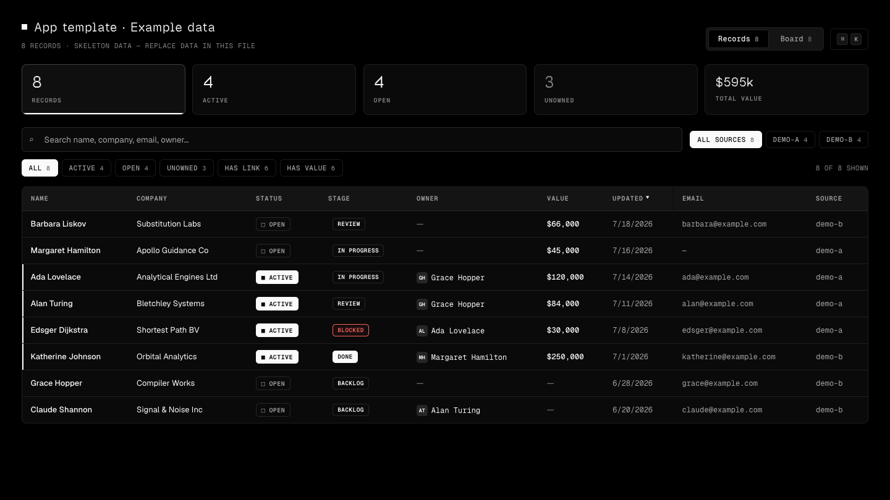
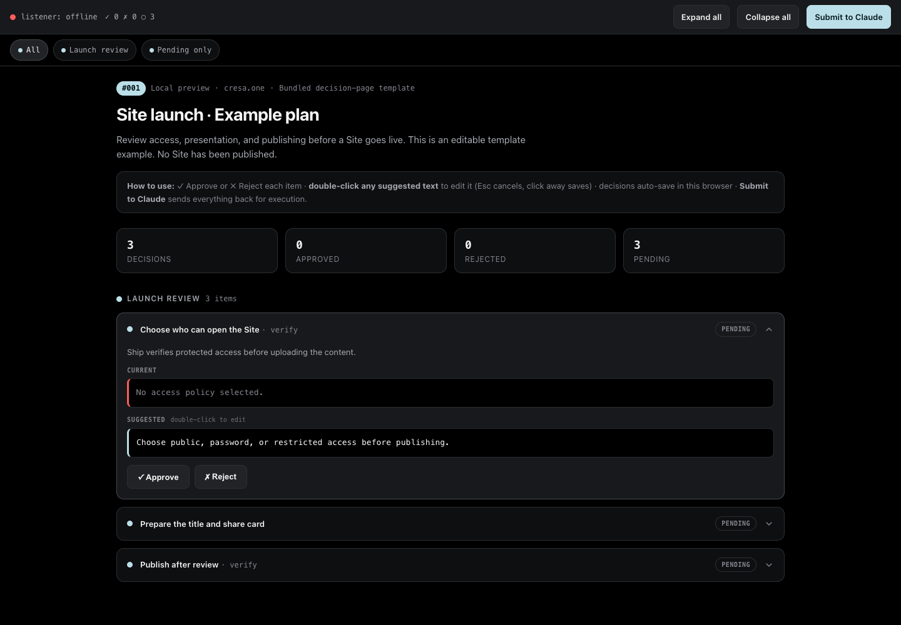
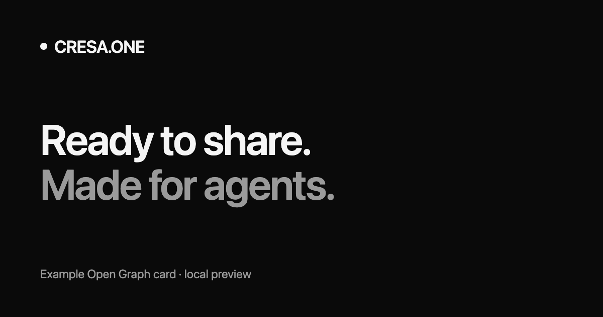

# cresa.one plugin

Publish Sites with verified access, metadata, and share cards; manage, health-check, and protect them. Keep project files in private account-owned Drives.

## Start here

Ask your agent to prepare a local website, publish a report, check a Site, or store files in a Drive. For preparation without publishing, ask for an **offline dry run**.

- “Prepare this site for cresa.one with metadata and a matching share card; dry run only.”
- “Publish this report as a restricted Site and verify its access settings.”
- “Upload these project files to my private cresa.one Drive.”

## Skills

Claude Code exposes each skill as `/cresa-one:<name>`; Codex lists the same skills as `cresa-one:<name>`. Agents also pick them automatically from the request.

| Skill | Use it to |
| --- | --- |
| `/cresa-one:publish` | Publish a website, app, report, or files with metadata, a share card, access, and verification |
| `/cresa-one:manage-sites` | Find, update, retag, rename, archive, claim, recover, or delete existing Sites |
| `/cresa-one:site-health` | Run a read-only check: HTTP, TLS, finalize state, status, expiry, access gate, share image, traffic, 404s |
| `/cresa-one:site-access` | Set a password, restrict to emails or domains, send invites, toggle link previews, or reopen a Site |
| `/cresa-one:drive` | Store, read, import, export, and share private files in Drives with scoped tokens |
| `/cresa-one:domains` | Connect custom domains, read DNS and SSL status, manage the handle and path links |
| `/cresa-one:site-data` | Collect form and poll records with Site Data, and forward protected paths with proxy routes |
| `/cresa-one:cresa-one` | The complete core skill: every workflow, API key sign-in, version checks, and the shared runtime |

`/cresa-one:status` reports bundled versions and helper paths.

## Included

The focused skills are thin guides. They all run the one runtime inside `skills/cresa-one/`, so helpers are never duplicated:

- `skills/cresa-one/scripts/ship.sh`: prepare HTML, generate share cards, configure and verify access, publish, and check saved settings.
- `publish.sh`: publish files or update a Site's metadata.
- `site-health.sh`: read-only health report for one Site.
- `drive.sh`: manage private Drive files and scoped Drive tokens.
- App and editable decision-page templates, share-card templates, and shipping reference docs.

Paths above are relative to the installed plugin directory. Each focused skill finds the runtime at `../cresa-one/` from its own directory; do not assume the user's working directory is the plugin.

## Requirements and access

Core helpers use Bash, curl, and jq. On Windows they run in Git Bash, which Claude Code on Windows already requires. Complete Site preparation requires Python 3.10+ (`python3`, `python`, or `py -3`). Share-card rendering optionally uses Playwright with Chromium; Pillow is the fallback.

Anonymous Sites are temporary. Owner-managed publishing, metadata, access, and Drive operations require a cresa.one account API key. A Drive owner can share one Drive or folder with another agent through a scoped, revocable Drive token. Keep credentials in the supported credential store or environment, never in chat. No OAuth or MCP server is installed by this plugin.

`--privacy private` controls search indexing, referrer policy, and profile listing. Select `--access password` or `--access restricted` when content must be gated. Ship checks protected access before upload and reports the actual expiry returned by the service.

## Preview gallery

These are local renders of bundled templates, not live account records or marketplace UI screenshots.







## Install and update

After this release reaches the public mirror, add `cresadotone/skill` as a marketplace, then install `cresa-one@cresa-one`. In Claude Code 2.1.275 or later, one line does both:

```text
/plugin install cresa-one --marketplace cresadotone/skill
```

Full platform-specific steps and local checkout instructions: [public README](https://github.com/cresadotone/skill#readme).

Update this package through the platform's plugin manager. The standalone hosted installers (`install.sh`, `install.ps1`) manage a separate skill installation and do not update plugin caches.

## Links

[Product documentation](https://cresa.one/docs) · [API reference](https://cresa.one/openapi.json) · [Source and issues](https://github.com/cresadotone/skill)

License: MIT.
