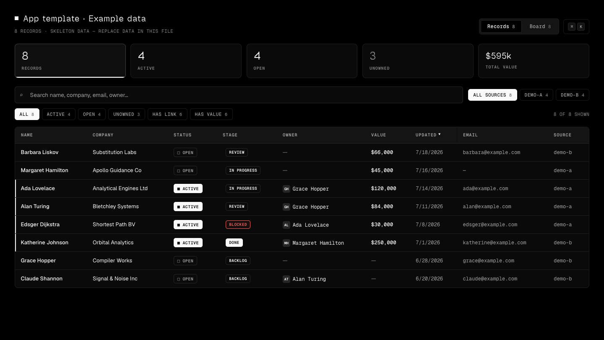
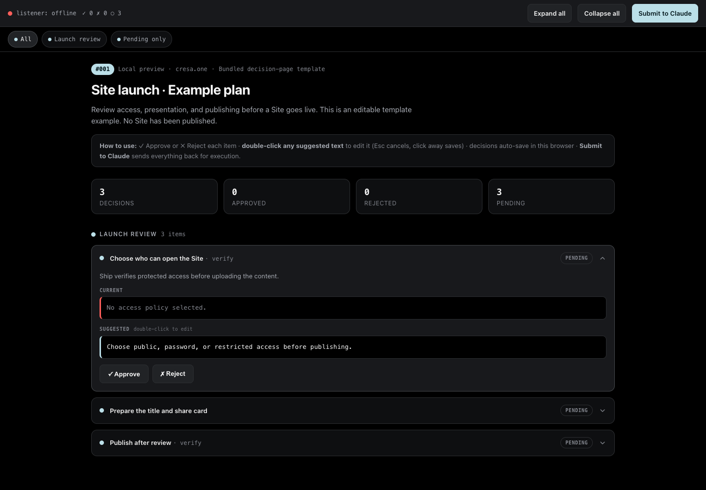
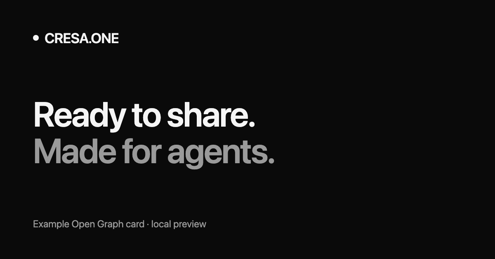

# cresa.one


Publish Sites with verified access, metadata, and share cards. Keep project files in private account-owned Drives. Includes publishing helpers, app templates, and editable decision pages.

Marketplace install instructions below apply after this release reaches the public mirror. To preview an unreleased branch, use the local checkout instructions.

## Claude Code plugin

```text
/plugin marketplace add cresadotone/skill
/plugin install cresa-one@cresa-one
```

Use `/cresa-one:cresa-one` for publishing and storage, or `/cresa-one:status` for bundled versions and helper paths. Update through the plugin manager:

```text
/plugin marketplace update cresa-one
/plugin update cresa-one@cresa-one
/reload-plugins
```

## Codex plugin

```bash
codex plugin marketplace add cresadotone/skill
codex plugin add cresa-one@cresa-one
```

The plugin appears as **cresa.one**, with prompt starters, a composer icon, and three preview screenshots. Start a new task after installing or updating to load the new skills.

```bash
codex plugin marketplace upgrade cresa-one
codex plugin add cresa-one@cresa-one
```

Both marketplaces install the same self-contained `plugins/cresa-one/` package. They include the canonical skill under `skills/cresa-one/`, matching assets, and a plugin-specific status command. Plugin release metadata lives in [plugin.config.json](plugin.config.json); skill versions are tracked separately.

### Test a local checkout

From the private repository root, replace the marketplace source with `./skill` in either platform's add command. For Claude: `/plugin marketplace add ./skill`; for Codex: `codex plugin marketplace add ./skill`. In a checkout of the public mirror, use `.`. These commands register a local marketplace; use the public source when installing a released version.

### Preview gallery

Local renders of the actual bundled templates; example data is labeled. [Full plugin guide and gallery](PLUGIN.md) · [Asset provenance](assets/README.md).







## Standalone skill install

```bash
npx skills add cresadotone/skill --skill cresa-one -g
```

Or without npm:

```bash
curl -fsSL https://cresa.one/install.sh | bash
```

Fallback installer also installs `/cresa-one` for Claude Code/Cowork. Typing `/cresa-one` checks live skill metadata and automatically runs the hosted installer when a newer version exists, so local skill files, helper scripts, bundled `jq`, and the command update together.

The standalone installer does not update plugin caches. Use the platform's plugin update commands when installed through a marketplace.

Each fallback install/update also packages portable archives at `~/.claude/skills/cresa-one/packages/`:

- `cresa-one-{version}.skill`
- `cresa-one-{version}.zip`

Installer output includes `present files to the user` followed by both paths so agents can attach or reveal them for quick installation in Claude Desktop, Codex, or similar apps.

### Install in Hermes

Direct from the public GitHub skill repo:

```bash
hermes skills install cresadotone/skill/hermes/productivity/cresa.one
```

Or via the well-known endpoint on `cresa.one`:

```bash
hermes skills install well-known:https://cresa.one/.well-known/skills/cresa.one
```

## Docs

Full documentation: **https://cresa.one/docs**

## Complete Site publishing

Version 1.26.1 includes `ship.sh`, `inject-meta.py`, `og-card.py`, and `reference/ship.md` in every install and portable archive. For authenticated HTML Sites:

```bash
bash ./cresa-one/scripts/ship.sh ./site --slug market-rent-calculator \
  --title "Market Rent Calculator" --description "Compare market rent scenarios." \
  --privacy private --access restricted --allow-emails viewer@example.com
```

Ship reserves new protected Sites without publishing content, verifies access before upload, and checks metadata and profile listing. `--dry-run` prepares local deliverables without network calls. `--privacy private` controls indexing/referrers and unlisting; access still needs `--access` when the page must be gated.

## Site Metadata

Use the skill's `publish.sh --metadata-only --slug {slug}` helper, or `PATCH /api/v1/publish/{slug}/metadata`, to update dashboard/UI title, description, and share-preview image without re-uploading HTML. Put `og.png` in the Site directory and set `--og-image-path /og.png`; Drive-only files are private and are not public OG image URLs.

## Media Types

The publish and Drive helpers preserve common web content types, including AVIF/WebP/HEIC/TIFF images, MP4/MOV/WebM video, FLAC/AIFF/ALAC/M4A/AAC/WAV/MP3/OGG/Opus/MIDI audio, fonts, WebAssembly, web manifests, archives, structured data, SQLite/parquet files, and glTF/GLB/USDZ/STL models.

## Design system & templates

- `cresa-one/templates/` - the SF Ownership Desk design system (`DESIGN.md`) plus production single-file templates: `app-template.html` (near-black mono app skeleton with themes, ⌘K command bar, table/board views, drawer, keyboard layer) and `plan-template.html` (interactive plan/decision page). The bundled `og-image.py` generates share cards in the same design language. See `cresa-one/templates/README.md` for scaffolding steps.

## Examples

- `examples/terminal-instrument/` - optional pattern for consistent self-contained apps with a shared shell, config-driven runtime, and Open Graph image generator.

## Source

This public skill bundle is synced from the private cresa.one product repo. Make changes in the private repo under `skill/`; the public `cresadotone/skill` repo is the mirror used for installs.

## License

MIT
